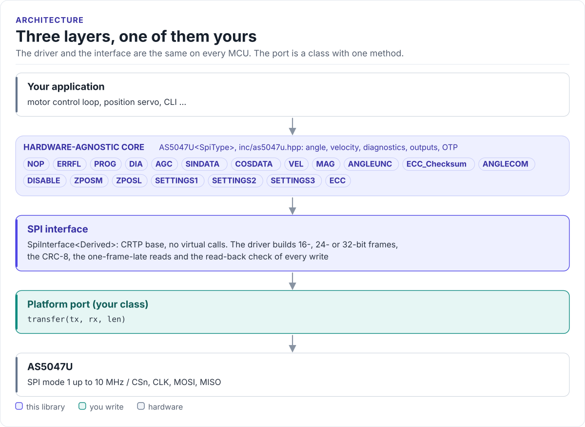

# AS5047U Driver

A C++20 driver for the ams OSRAM AS5047U 14-bit magnetic rotary position sensor: read angle, velocity and field
diagnostics, configure the ABI, UVW and PWM outputs and program the OTP, from any MCU with SPI.

[](https://github.com/hardfoc/hf-as5047u-driver/actions/workflows/ci-host-tests.yml)
[](https://github.com/hardfoc/hf-as5047u-driver/actions/workflows/esp32-examples-build-ci.yml)
[](https://hardfoc.github.io/hf-as5047u-driver/)
[](LICENSE)

**Documentation: <https://hardfoc.github.io/hf-as5047u-driver/>**

<!-- figure: driver-layers -->
<picture>
  <source media="(prefers-color-scheme: dark)" srcset="docs/diagrams/driver-layers.dark.svg">
  
</picture>
<!-- /figure -->

## In 30 seconds

Write a port class for your MCU (one `transfer()` method;
[Porting](https://hardfoc.github.io/hf-as5047u-driver/latest/porting/)), then:

<!-- generated: quickstart-code -->
```cpp
#include "as5047u.hpp"

#include <cstdio>

int print_angle(MySpi& spi) {
  as5047u::AS5047U<MySpi> encoder(spi, FrameFormat::SPI_24);  // CRC on every frame

  const auto dia = encoder.GetDiagnostics();         // 1. chip up, magnet in range?
  if (dia.bits.LoopsFinished == 0U || dia.bits.MagHalf_flag != 0U) {
    return -1;                                       // no supply, no SPI or no magnet
  }

  const float degrees = encoder.GetAngleDegrees(2);  // 2. angle, 2 retries on CRC
  const float rpm = encoder.GetVelocityRPM();        // 3. velocity
  std::printf("%.2f deg  %.1f rpm  AGC %u\n", degrees, rpm, encoder.GetAGC());
  return 0;
}
```
<!-- /generated -->

## What it does

- Reads the 14-bit angle with or without dynamic angle error compensation, velocity in LSB, °/s, rad/s or rpm,
  AGC, field magnitude and the diagnostic register.
- Talks all three SPI frame formats: 16 bit for speed, 24 bit with CRC-8, 32 bit with a PAD byte for daisy chains.
- Checks every register write by reading it back on the next frame, with optional retries.
- Configures zero position, direction, adaptive filter, ABI resolution, index width, UVW pole pairs, PWM pin and
  hysteresis, and burns them to OTP with `ProgramOTP()`.
- No heap, no exceptions, no RTOS, no virtual calls (the port is a CRTP class).

## Install

```bash
git submodule add https://github.com/hardfoc/hf-as5047u-driver.git external/hf-as5047u-driver
```

```cmake
add_subdirectory(external/hf-as5047u-driver)
target_link_libraries(my_app PRIVATE hf_as5047u)
```

ESP-IDF: use the component wrapper in [`examples/esp32/components/hf_as5047u`](examples/esp32/components/hf_as5047u/CMakeLists.txt).
Details: [Installation](https://hardfoc.github.io/hf-as5047u-driver/latest/installation/).

## Documentation

| | |
| --- | --- |
| [Quickstart](https://hardfoc.github.io/hf-as5047u-driver/latest/quickstart/) | Wire it, write the port, read an angle |
| [Hardware](https://hardfoc.github.io/hf-as5047u-driver/latest/hardware/) | Pins, bus settings, timing, power modes, magnet |
| [API guide](https://hardfoc.github.io/hf-as5047u-driver/latest/api-guide/) | Read, configure, set up outputs, handle errors |
| [SPI protocol](https://hardfoc.github.io/hf-as5047u-driver/latest/protocol/) | Frames, CRC, and what each call costs on the bus |
| [Examples](https://hardfoc.github.io/hf-as5047u-driver/latest/examples/) | ESP32 applications |
| [API reference](https://hardfoc.github.io/hf-as5047u-driver/latest/api/) | Doxygen, every class and member |

The pages are in [`docs/`](docs/index.md); the datasheet is in [`docs/datasheet/`](docs/datasheet/).

## Tests

```bash
cmake -S . -B build-host -DHF_AS5047U_BUILD_TESTS=ON && cmake --build build-host && ctest --test-dir build-host
```

The host tests run the driver against a model of the chip; the code on the documentation site is compiled by the
same build.

## License

GPL-3.0. See [LICENSE](LICENSE).
