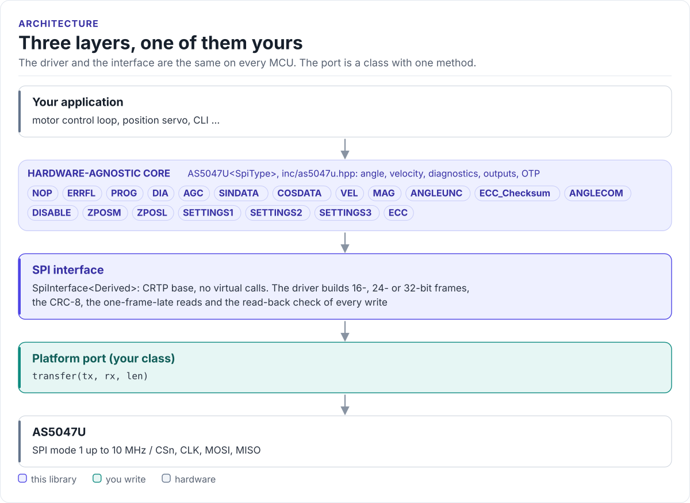
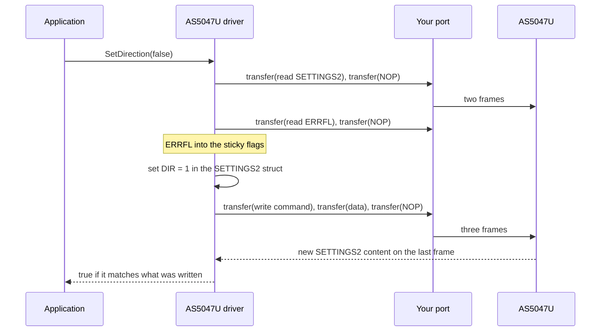

# Architecture

How the driver is put together: three layers, what each owns, and how one call reaches the chip.

<!-- figure: driver-layers -->
<picture>
  <source media="(prefers-color-scheme: dark)" srcset="diagrams/driver-layers.dark.svg">
  
</picture>
<!-- /figure -->

## The three layers

| Layer | Where | You change it |
| --- | --- | --- |
| **Core**: `AS5047U<SpiType>`, typed registers | [`inc/as5047u.hpp`](../inc/as5047u.hpp) and the headers beside it | Never, for a new board |
| **SPI interface**: `SpiInterface<>` | [`as5047u_spi_interface.hpp`](../inc/as5047u_spi_interface.hpp) | Never |
| **Platform port**: your class | Your project | Once per MCU or board ([Porting](porting.md)) |

The core depends only on the port's `transfer()`. Everything above the port is the same on ESP32, STM32, a Linux host or the unit-test model of the chip. That is
how the [host tests](testing.md) run the real driver code without hardware.

## How one call reaches the chip

Each setter is a read-modify-write of one register, so it leaves the other fields of that register as they were.
If a `transfer()` returns `false`, or a reply the driver uses has a wrong CRC, the call stops at that frame and
returns `false`; when that happens during the read, nothing is written.

## Why CRTP

The interface is a class template parameter, not a virtual base class. The compiler sees your port's
`transfer()` directly and can inline it; the driver has no vtable, allocates nothing and needs no RTTI. The
cost is that the driver type names the port: `AS5047U<MySpi>`. Code that has to work with several port types
takes the driver as a template parameter too.

## Names and namespaces

| Name | Kind | Where |
| --- | --- | --- |
| `as5047u::AS5047U<SpiType>` | The driver | `inc/as5047u.hpp` |
| `as5047u::SpiInterface<Derived>` | The port's base class | `inc/as5047u_spi_interface.hpp` |
| `as5047u::AngleUnit`, `as5047u::VelocityUnit` | Units for `GetAngle()` and `GetVelocity()` | `inc/as5047u.hpp` |
| `FrameFormat`, `FilterPreset` | Global enums | `inc/as5047u_types.hpp` |
| `AS5047U_Error` | Global enum of ERRFL flags | `inc/as5047u.hpp` |
| `AS5047U_REG::*` | One struct per register, with `ADDRESS`, `value` and `bits` | `inc/as5047u_registers.hpp` |
| `AS5047U_CFG::*` | Compile-time defaults | `inc/as5047u_config.hpp` |

## Source map

| Path | Contents |
| --- | --- |
| `inc/as5047u.hpp` | `AS5047U<SpiType>`: the public API, unit helpers, version |
| `src/as5047u.ipp` | Template implementation, included by the header |
| `inc/as5047u_registers.hpp` | Every register as a struct with bit fields and enums |
| `inc/as5047u_spi_interface.hpp` | The CRTP SPI interface |
| `inc/as5047u_types.hpp`, `inc/as5047u_config.hpp` | Frame format and filter enums, compile-time defaults |
| `cmake/hf_as5047u_build_settings.cmake` | Target name, include directories, version |
| `tests/` | Host unit tests and the compiled documentation snippets |
| `examples/esp32/` | ESP-IDF applications |
