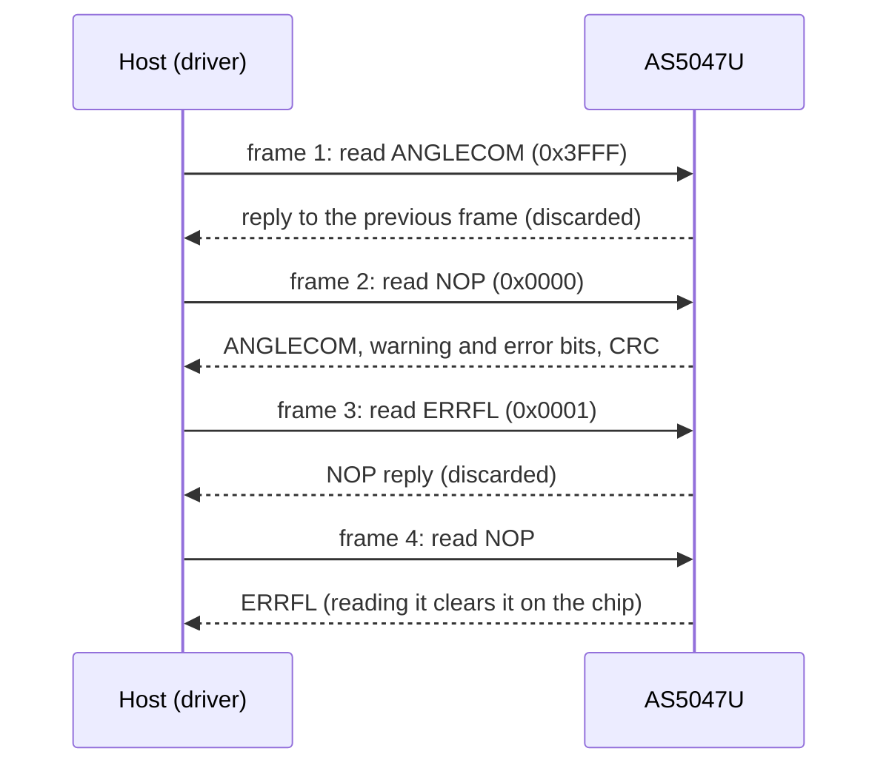

# Hardware

What to connect between your MCU and an AS5047U, with which bus settings, and how to power it and place the
magnet.

All values here come from the [AS5047U datasheet](datasheet/AS5047U_DS000637_1-01.pdf) (DS000637, v1-01,
2020-12-16). Figure numbers refer to it.

{ .hf-plate }

## Pins

TSSOP-14 (Figure 3 and 4). Directions are seen from the chip.

| Pin | Name | Direction | Function | If unused |
| --- | --- | --- | --- | --- |
| 1 | `CSn` | in | SPI chip select, active low | Pull up |
| 2 | `CLK` | in | SPI clock | Pull down |
| 3 | `MISO` | out | SPI data out | Leave open |
| 4 | `MOSI` | in | SPI data in | Pull down |
| 5 | `TEST` | | Test pin | Always connect to GND |
| 6 | `B` | out | Incremental signal B | Leave open |
| 7 | `A` | out | Incremental signal A | Leave open |
| 8 | `W/PWM` | out | Commutation W, or PWM angle | Leave open |
| 9 | `V` | out | Commutation V | Leave open |
| 10 | `U` | out | Commutation U | Leave open |
| 11 | `VDD` | power | Supply; 5 V into the on-chip LDO, or 3.3 V | |
| 12 | `VDD3V3` | power | LDO output (1 µF to GND), or the 3.3 V supply | |
| 13 | `GND` | power | Ground | |
| 14 | `I/PWM` | out | Index pulse I, or PWM angle | Leave open |

Digital inputs must never float. The ABI, UVW and PWM outputs drive at most 4 mA at 5 V and 2 mA at 3.3 V into
at most 50 pF.

## Bus settings

| Setting | Value |
| --- | --- |
| Mode | SPI mode 1: CPOL = 0, CPHA = 1. The chip samples MOSI on the falling edge of CLK |
| Bit order | MSB first |
| Clock | Up to 10 MHz (tclk ≥ 100 ns) |
| Frame | 16 bits (reads only, no CRC), 24 bits (CRC-8) or 32 bits (CRC-8 and a PAD byte) |
| Chip select | Active low, one frame per low period. The chip executes the frame on the rising edge of CSn |
| Reply | The data for a read arrives during the **next** frame |
| Driver default | 16-bit frames (`AS5047U_CFG::DEFAULT_FRAME_FORMAT`); writes always go out as 24-bit frames |

[SPI protocol](protocol.md) shows the bits of each frame, the CRC and the read and write sequences.

## Timing

Figure 19. The two 350 ns limits are the ones a port can break: CSn low to the first clock edge, and CSn high
between two frames. A hardware chip select usually meets them with one or two clock cycles of set-up and hold; a
GPIO chip select toggled right next to the transfer may not.

| Symbol | Parameter | Min | Max | Unit |
| --- | --- | --- | --- | --- |
| tL | CSn falling edge to first CLK rising edge | 350 | | ns |
| tclk | Clock period | 100 | | ns |
| tclkH, tclkL | Clock high and low time | 50 | | ns |
| tH | Last CLK falling edge to CSn rising edge | tclk / 2 | | ns |
| tCSn | CSn high time between frames | 350 | | ns |
| tMOSI | MOSI valid before the clock edge | 20 | | ns |
| tMISO | Clock edge to MISO valid | | 51 | ns |
| tOZ | CSn rising edge to MISO high-impedance | | 10 | ns |

The 350 ns minimums come from synchronizing to the internal 9 MHz clock (2 × tCLK_SYS + 10 ns).

## Power

| Mode | Supply pins | Temperature | Noise (rms) |
| --- | --- | --- | --- |
| 5 V | VDD 4.5 V to 5.5 V; VDD3V3 is the LDO output, 1 µF to GND | −40 °C to 150 °C | 0.068° |
| 3.3 V, `NOISESET` = 0 | VDD and VDD3V3 tied, 3.0 V to 3.6 V | −40 °C to 125 °C | 0.068° |
| 3.3 V, `NOISESET` = 1 | VDD and VDD3V3 tied, 3.0 V to 3.6 V | −40 °C to 150 °C | 0.082° |

The LDO powers nothing but the chip. Select `NOISESET` with `Set150CTemperatureMode()`.

- Supply current is at most 16 mA. Put 100 nF from VDD to GND in both modes.
- The first valid angle is available at most 10 ms after VDD rises above its minimum (tpon).
- The logic levels follow VDD: VIH ≥ 0.7 × VDD, VIL ≤ 0.3 × VDD. In 5 V mode a 3.3 V MCU
  needs a level shifter on CLK, MOSI and CSn (0.7 × 4.5 V = 3.15 V), and MISO swings up to VDD.
- Absolute maximum: 7.0 V on VDD, 5.0 V on VDD3V3.
- OTP programming needs 4.5 V to 5.5 V (5 V mode) or 3.3 V to 3.5 V (3.3 V mode), up to 100 mA, at 5 °C to
  45 °C. See [OTP programming](otp.md).

`GetDiagnostics().bits.VDD_mode` reads 1 in 5 V mode and 0 in 3.3 V mode.

## Magnet

| Parameter | Value |
| --- | --- |
| Type | Diametrically magnetized (two poles across the diameter), centered on the package axis |
| Field at the die | 35 mT to 70 mT, orthogonal component, along a circle of 1.1 mm radius |
| Datasheet reference magnet | N35H, 8 mm diameter, 3 mm thick |
| Speed | Up to 28000 rpm |
| Accuracy (optimal placement) | ±0.8° at 25 °C, ±1° over −40 °C to 150 °C (maximum non-linearity) |

The AGC keeps the field magnitude constant while the field is in range; AGC at 0 or 255 means the magnet is too
close or too far. Read ERRFL or AGC regularly: the datasheet requires one of them to be read for the AGC loop to
work as specified.

## Outputs other than SPI

| Output | Pins | What it carries | Driver calls |
| --- | --- | --- | --- |
| ABI | A, B, I/PWM | Quadrature, 25 to 4096 pulses per turn; index once per turn, 3 LSB or 1 LSB wide. All high during start-up | `SetABIResolution()`, `SetIndexPulseLength()` |
| UVW | U, V, W/PWM | Hall-sensor emulation for 1 to 7 pole pairs. All low during start-up | `SetUVWPolePairs()` |
| PWM | W/PWM or I/PWM | 12-bit angle in a frame of 4119 PWM clocks of 444 ns typical (about 1.83 ms) | `ConfigureInterface(..., pwm)` |

The PWM pin is W when ABI is active and I when UVW is active (`SETTINGS2.UVW_ABI`). The PWM angle is not
dynamically compensated. [Configuration](configuration.md) has the combinations.

## The examples' board

The [ESP32 examples](examples.md) build for an ESP32-S3 (`examples/esp32/app_config.yml`) with the sensor on
SPI2: CS GPIO10, MOSI GPIO11, SCLK GPIO12, MISO GPIO13, mode 1 at 1 MHz. The assignment is in
[`esp32_as5047u_test_config.hpp`](../examples/esp32/main/esp32_as5047u_test_config.hpp).

## Reference documents

| Document | What it is for |
| --- | --- |
| [AS5047U datasheet](datasheet/AS5047U_DS000637_1-01.pdf) | Pins, electrical limits, SPI frames, registers, OTP procedure |
| Application note *AS5x47U Adaptive Filter* (ams OSRAM) | Choosing K_min and K_max for the adaptive filter |
