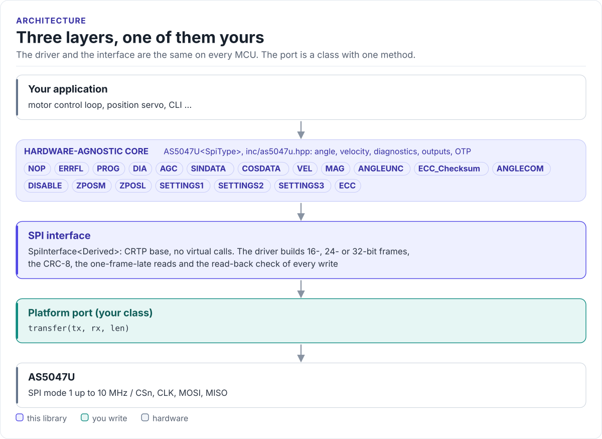

# Porting

Run the driver on a new MCU by writing one class with one method: the SPI transfer.

The driver never calls your SDK directly. It calls `transfer()` on a class you derive from
`as5047u::SpiInterface<Self>` (in [`inc/as5047u_spi_interface.hpp`](../inc/as5047u_spi_interface.hpp)). The base
class uses CRTP: the call is resolved at compile time, so there are no virtual functions, no vtable and nothing to
allocate.

<!-- figure: driver-layers -->
<picture>
  <source media="(prefers-color-scheme: dark)" srcset="diagrams/driver-layers.dark.svg">
  
</picture>
<!-- /figure -->

## What you implement

| Method | Contract |
| --- | --- |
| `void transfer(const uint8_t* tx, uint8_t* rx, std::size_t len)` | Pull CSn low, clock out `len` bytes from `tx` while storing `len` bytes into `rx`, release CSn. `len` is 2, 3 or 4. The driver always passes both buffers |

The driver builds every byte of every frame, including the CRC and the PAD; your port only moves bytes.

## The port

```cpp title="my_spi.hpp"
--8<-- "tests/docs/my_spi.hpp:port"
```

Rules the transfer must follow:

- **SPI mode 1** (CPOL = 0, CPHA = 1), MSB first, up to 10 MHz. The clock idles low and the chip samples MOSI on
  the falling edge; modes 0, 2 and 3 do not work.
- **One frame per call.** CSn goes low before the first byte and high after the last. The chip executes the frame
  on the rising edge of CSn, so never merge two calls into one chip-select period, and never split one.
- **CSn timing.** At least 350 ns from CSn low to the first clock edge, and at least 350 ns of CSn high between
  frames ([Hardware](hardware.md#timing)).
- **Blocking.** Return only when the frame is complete and `rx` is filled. The driver uses the reply of one call to
  build the next.
- **No error return.** `transfer()` returns `void`; a bus failure you cannot hide should be logged by the port.
  The chip's ERRFL then reports the framing or CRC error on the next read.

## Reference implementation

The ESP32 examples use [`esp32_as5047u_bus.hpp`](../examples/esp32/main/esp32_as5047u_bus.hpp): an ESP-IDF
`spi_master` device in mode 1 with hardware chip select (`spics_io_num`), one `spi_device_transmit()` per frame,
and optional logging of every frame. Start from it for any ESP-IDF target.

## Check your port

1. Build it: the port on this page is compiled by the host CI from [`tests/docs/`](../tests/docs/my_spi.hpp), with
   the driver instantiated over it (`template class as5047u::AS5047U<MySpi>;`).
2. Read DIA with `GetDiagnostics()`: `LoopsFinished` = 1 and a plausible `VDD_mode` prove that reads work.
3. Read ERRFL with `GetErrorFlags()` twice: the second read should be 0. A persistent `Framing_error` or
   `CRC_error` points at the mode, CSn handling or the frame length.
4. Write a setting and read it back: `SetDirection(false)` must return `true`, and `ReadReg<AS5047U_REG::SETTINGS2>()`
   must show `DIR` = 1.
5. On a logic analyzer, the read of ANGLECOM in `SPI_24` mode is `7F FF BD` (`0xBD` is the CRC of `0x7FFF`), followed by
   the NOP `40 00 1B`.

## Threads

The driver is not thread-safe. Give each sensor one owner task, or guard every call on a driver object (and its
port) with one mutex. Several sensors on separate chip selects can share a bus only if the bus driver serializes
whole frames.
