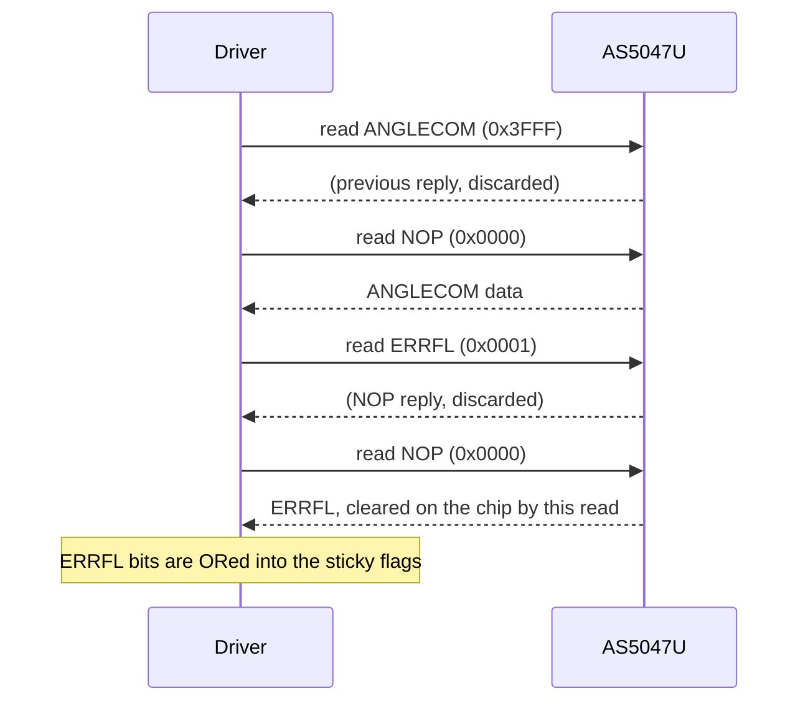
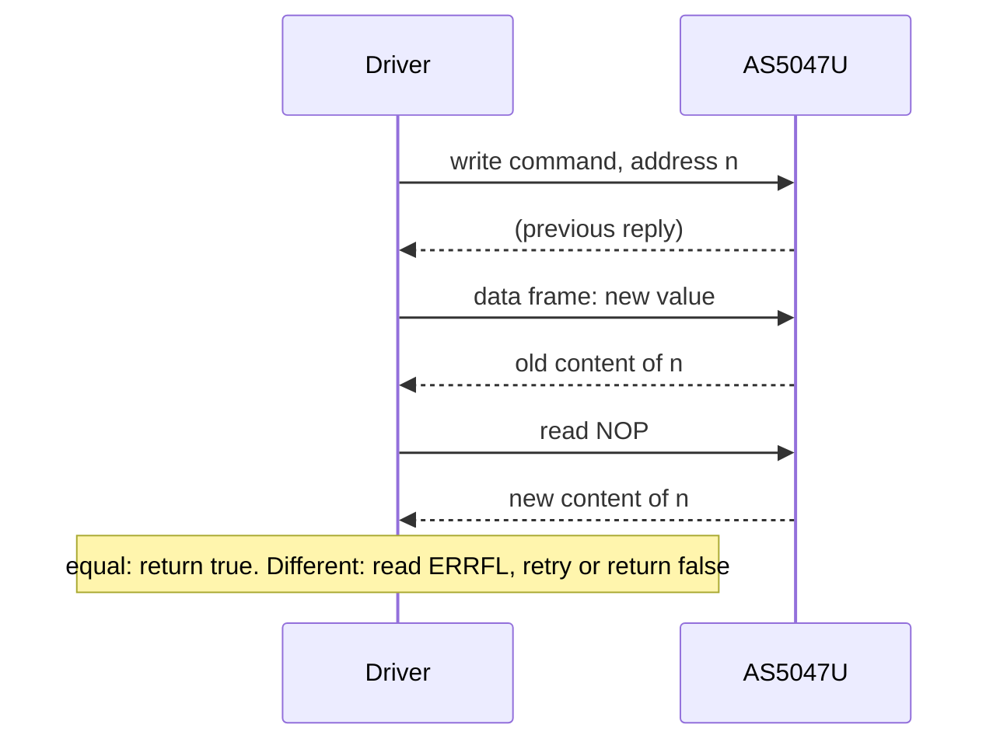

# SPI protocol

The three frame formats, the CRC, and the frame sequences the driver sends for a read and a write, with what each
costs on the bus.

The source is the datasheet's "SPI Transaction" section (Figures 20 to 31). The driver's side is
`rawReadRegister()` and `writeRegister()` in [`src/as5047u.ipp`](../src/as5047u.ipp).

## Frame formats

| Format | MOSI (host to chip) | MISO (chip to host) | Use |
| --- | --- | --- | --- |
| 16 bit | `[15]` don't care, `[14]` R = 1, `[13:0]` address | `[15]` warning, `[14]` error, `[13:0]` data | Reads only, no CRC |
| 24 bit | `[23]` don't care, `[22]` RW, `[21:8]` address, `[7:0]` CRC | `[23]` warning, `[22]` error, `[21:8]` data, `[7:0]` CRC | Reads and writes |
| 32 bit | `[31:24]` PAD, `[23]` don't care, `[22]` RW, `[21:8]` address, `[7:0]` CRC | `[31]` warning, `[30]` error, `[29:16]` data, `[15:8]` CRC, `[7:0]` PAD | Daisy chains |

RW is 1 for a read and 0 for a write. The warning and error bits report a problem in the **previous** command
frame; the details are in ERRFL.

Pick the format with the constructor or `SetFrameFormat()`:

| `FrameFormat` | Bytes per frame | Reads | Writes |
| --- | --- | --- | --- |
| `SPI_16` | 2 | 16-bit frames | Sent as 24-bit frames, then back to 16 bit |
| `SPI_24` | 3 | 24-bit frames | 24-bit frames |
| `SPI_32` | 4 | 32-bit frames, PAD from `SetPad()` | 32-bit frames |

The datasheet allows 16-bit frames for reads only, so the driver promotes every write in `SPI_16` mode to a
24-bit frame.

## CRC

| Parameter | Value |
| --- | --- |
| Width | 8 bit |
| Polynomial | `0x1D` (x8 + x4 + x3 + x2 + 1) |
| Initial value | `0xC4` |
| Reflection | None, in or out |
| Final XOR | `0xFF` |
| Covered bits | 24-bit frames and the 32-bit command frame: bits 23:8. 32-bit reply: bits 31:16. The PAD is never covered |

The initial value makes an all-zero frame invalid: `0x000000` would otherwise be a valid command. The driver
computes it with `AS5047U<>::ComputeCRC8(uint16_t)`, a `constexpr` function; the host tests check it against an
independent implementation for all 65536 inputs.

A frame whose CRC is wrong is not executed and sets `CRC_error` in ERRFL. The driver also computes the CRC of each
24- and 32-bit reply but does not act on a mismatch: errors reach your code through ERRFL and the sticky flags
([API guide](api-guide.md#handle-errors)).

## Read

The chip executes a command at the rising edge of CSn and returns the result during the next frame. One driver
read is therefore four frames: the read command, a NOP that clocks the data out, then the same for ERRFL, so that
every read also collects the error flags.

## Write

A write is a command frame with RW = 0 followed by a data frame with the new 14-bit value. During the data frame
the chip sends the old content; during the next frame it sends the new content. The driver sends a NOP as that
next frame and compares what comes back with what it wrote.

On a mismatch the driver reads ERRFL, prints one line with the address, the expected and the read-back value and
the CRC, framing and command error bits (through `printf`), and tries again up to `retries` times.

## What a call costs

Frames per call, from the sequences above. Times are derived for 24-bit frames at 10 MHz (2.4 µs of clock per
frame, plus at least 350 ns of CSn high between frames and your port's own overhead); they are not measurements.

| Call | Frames | Clock time at 10 MHz |
| --- | --- | --- |
| `GetAngle()`, `GetVelocity()`, `GetAGC()`, `ReadReg<>()` | 4 | 9.6 µs (6.4 µs with `SPI_16`) |
| `GetZeroPosition()` | 8 | 19.2 µs |
| `WriteReg()` | 3 | 7.2 µs |
| `SetDirection()`, `SetABIResolution()` and other one-field setters | 7 (read, then write) | 16.8 µs |
| `ConfigureInterface()` | 14 | 33.6 µs |

A failed write verification adds four frames for ERRFL and repeats the write.

## Daisy chains and the PAD byte

In a 32-bit frame the PAD byte leads the MOSI frame and trails the MISO frame. The datasheet allows any number of
PAD bits before the MOSI data so that the host can tell which device's reply it is reading. The driver sends one
PAD byte, the value set with `SetPad()`, at the start of every 32-bit frame; it does not interpret the PAD on MISO.
